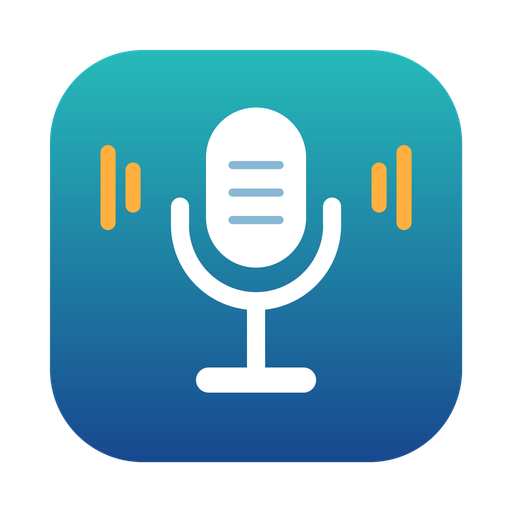

<p align="center">
  
</p>

<h1 align="center">SprachZuText für Intel-Mac</h1>

<p align="center">
  Diktieren auf dem Intel-Mac: lokal berechnet, ohne Konto, ohne Server.
</p>

> **Inoffizieller Fork.** SprachZuText ist ein unabhängiger Fork von [cmagnussen/blitztext-app](https://github.com/cmagnussen/blitztext-app) (Blitztext). Es stammt nicht von Blackboat Internet GmbH und wird von ihr weder betrieben noch unterstützt oder geprüft. Name, Logo und Icon des Originals sind nicht enthalten, siehe [TRADEMARKS.md](TRADEMARKS.md).

Halte ein Tastenkürzel, sprich, lass los. SprachZuText wandelt deine Sprache in Text um und fügt ihn dort ein, wo dein Cursor steht. Die Spracherkennung läuft auf deinem Mac. Kein Konto, kein Server, kein Audio verlässt das Gerät.

## Wozu dieser Fork?

Das Original ist für Apple Silicon und Xcode 26 gebaut. Auf einem Intel-Mac stürzt es beim Diktieren kommentarlos ab. Dieser Fork behebt das:

- **Absturz auf Intel behoben.** Auf Intel-Macs rechnet WhisperKit mit 32-Bit-Zahlen, Core ML liefert aber 16-Bit-Zahlen. Das führte zu falschen Speicherzugriffen. Der Patch [`patches/whisperkit-intel.patch`](patches/whisperkit-intel.patch) korrigiert das. `build.sh` wendet ihn beim Bauen automatisch an.
- **Nur Prozessor.** Die Spracherkennung rechnet ausschließlich auf der CPU, denn der GPU-Weg bricht auf älteren Intel-Macs mit einem Core-ML-Fehler ab.
- **Baut mit Xcode 16.2** (getestet unter macOS 14.6.1), statt Xcode 26 zu verlangen.
- **Eigene Identität:** eigener Name, eigenes Icon, eigene Bundle-ID (`io.github.docviper.sprachzutext`). Die Auto-Updates sind abgeschaltet.

Getestet wurde auf einem iMac von 2015. Andere Intel-Macs sind nicht geprüft.

## Was du bekommst

- **Lokale Spracherkennung** mit OpenAI Whisper über WhisperKit (Small und Large v3 Turbo, etwa 100 Sprachen). Die Sprache wird erkannt.
- **Text am Cursor:** Leerzeichen und Großschreibung passen sich dem Text um den Cursor an. Passwortfelder werden nie gelesen. Danach wird deine Zwischenablage wiederhergestellt.
- **Schreibmodi** (SprachZuText+, $%&!, :)) mit einem eigenen Modell-Anbieter und API-Schlüssel: OpenAI, Anthropic, Google Gemini, Mistral, OpenRouter oder ein lokaler Server wie Ollama oder LM Studio. Getestet mit Gemini.
- **Modus je App oder Website**, **Wörterbuch**, **Verlauf** (verschlüsselt, nur auf deinem Mac) und Transkription von Audiodateien.

Nicht verfügbar auf Intel-Macs: Parakeet Ultra (braucht Apple Silicon) und die Schreibmodi mit Apple Intelligence.

## Geschwindigkeit

Ohne Neural Engine und GPU ist die Spracherkennung langsam. Auf dem iMac von 2015 dauert ein kurzer Satz mit Whisper Small etwa 45 Sekunden und mit Large v3 Turbo etwa 70 Sekunden. Neuere Intel-Macs sind schneller.

## Bauen und installieren

Es gibt keine fertige App zum Herunterladen, du baust sie selbst. Du brauchst einen Mac mit Intel-Prozessor, macOS 14 oder neuer, Xcode 16.2 oder neuer, Git und [XcodeGen](https://github.com/yonaskolb/XcodeGen) (`brew install xcodegen`).

```bash
git clone https://github.com/DocViper/blitztext-app.git
cd blitztext-app
./build.sh --install --run
```

Danach erlaubst du **Mikrofon** und **Bedienungshilfen** (zum Einfügen in andere Apps), lädst in den Einstellungen unter **Modelle** ein Whisper-Modell und diktierst. Die ausführliche Anleitung steht in [docs/setup.md](docs/setup.md).

## Bekannte Einschränkungen

- **Langsam** (siehe oben).
- **Bedienungshilfen nach jedem Neubau:** Die App ist nur ad hoc signiert. Nach einem Neubau entfernst du den alten Eintrag in **Systemeinstellungen > Datenschutz & Sicherheit > Bedienungshilfen** und fügst die neue App hinzu.
- **`fn`-Kürzel** funktionieren nur auf Apple-Tastaturen. Auf anderen Tastaturen legst du eigene Kürzel fest.
- **Whisper bei Stille** erfindet manchmal Sätze wie "Vielen Dank." Die bekannten werden herausgefiltert.
- **Die App ist auf Deutsch.**

## Datenschutz

```text
Spracherkennung:  dein Mac (Whisper über WhisperKit, nur CPU)
Schreibmodi:      dein eigener Modell-Anbieter mit deinem API-Schlüssel (optional)
Modell-Download:  Hugging Face, einmal pro Modell
Updates:          keine automatische Prüfung
```

SprachZuText hat kein Backend und sammelt keine Daten. Details in [docs/privacy.md](docs/privacy.md).

## Mitmachen und Support

Das ist ein Hobbyprojekt ohne Support-Zusage. Fehler und Ideen gern als GitHub Issue, siehe [SUPPORT.md](SUPPORT.md) und [CONTRIBUTING.md](CONTRIBUTING.md).

## Danksagung

- **[Blitztext](https://github.com/cmagnussen/blitztext-app)** von Blackboat und seinen Mitwirkenden, auf dem dieser Fork aufbaut
- **[WhisperKit](https://github.com/argmaxinc/argmax-oss-swift)** von Argmax und **OpenAI** für Whisper
- **[FluidAudio](https://github.com/FluidInference/FluidAudio)** und **[Sparkle](https://sparkle-project.org)**

Die vollständigen Lizenztexte stehen in [THIRD_PARTY_NOTICES.md](THIRD_PARTY_NOTICES.md) und in der App unter Einstellungen > Allgemein > Lizenzen und Hinweise.

## Lizenz

MIT-Lizenz, siehe [LICENSE](LICENSE). Der Urheberrechtshinweis des Originals bleibt erhalten. Es gibt keine Gewährleistung.
